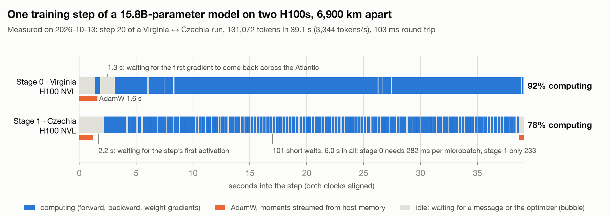
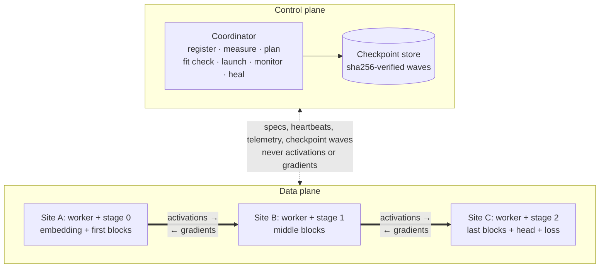

# Elysium

**Unifying the world's AI compute.**

Elysium trains one model on GPUs that live in different data centers, over the ordinary internet. We cut the model
into pipeline stages, put each stage wherever there is a GPU, and send only the activations between sites. Runs can be
checked bit for bit against the same model trained on a single device.

[Website](https://elysium-network.vercel.app/) · [How it works](#how-elysium-works) · [Quick start](#quick-start) ·
[Capabilities](#current-capabilities) · [Results](#benchmarks-and-evaluation) · [Roadmap](#roadmap) ·
[Contributing](#contributing)

<picture>
  <source media="(prefers-color-scheme: dark)" srcset="docs/assets/step-timeline-dark.png">
  
</picture>

<sub>One measured training step: a 15.8B-parameter model on two H100s 6,900 km apart, with both GPUs on the same
clock ([run report](benchmarks/wan/runs/2026-10-13-h100/REPORT.md)).</sub>

Elysium is early research software. So far we've trained dense GPT models from 607M to 25.1B parameters over the
public internet, on GPUs rented by the hour. Between Czechia and Denver, a 2.8B model produced the same 320 losses as a
single H100, bit for bit. A 15.8B model split between Virginia and Czechia reached 3,344 tokens/s, with the GPUs busy
90% and 78% of each step.

## The problem

Training stacks expect every GPU to sit in one building, exchanging gradients or weights every step over links like
NVLink that move terabytes per second [10]. Between data centers you get 1 to 10 Gb/s, so a synchronous step mostly
waits: in our first transatlantic run, the GPUs sat idle 72 to 79% of each step. And compute is scattered across pools
too small to train a large model alone, on different accelerators (NVIDIA and AMD GPUs, TPUs, Trainium) that can turn
the same math into different bits.

## The vision

We want AI compute to work as one programmable layer. You describe a training job once; the system measures the
machines and links available anywhere, places the work where it fits and runs best, and hands back the same model, bit
for bit, that one big machine would have produced. Today's engine covers fleets of NVIDIA GPUs of one model, or of one
architecture, across sites. The [target architecture](docs/VISION.md) adds GPUs, TPUs, Trainium and AMD in one run,
each stage on its own native runtime behind a common tensor contract.

## How Elysium works



## Quick start

**1. Install** with Python 3.10 or newer and [uv](https://docs.astral.sh/uv/). The demo runs on macOS (Apple Silicon);
GPU runs have used Linux with H100 and RTX cards. Windows hasn't been tried.

```bash
git clone https://github.com/virgiliolrf/elysium-wan.git
cd elysium-wan
uv sync
```

**2. Run the laptop demo.** No GPU needed, about 70 to 80 seconds on an M4 MacBook Air. Five workers in two emulated
regions (60 Mb/s, 60 ms round trip) run a four-stage pipeline with one spare, and one worker is killed at step 6.

```bash
uv run python examples/wan_cluster_demo.py --workers 5 --stages 4 --kill-at 6
```

The spare takes over, and the run ends with the same 240 losses as a single device:

```text
>>> killing w4 (agent and stage) at step >= 6
[coord error] slot (1, 0) convicted: worker unreachable: control connection lost 4s ago and not re-established
[coord info] replacement for slot (1, 0): w2 -- identical device (cpu) in the dead node's region: the healed run stays bit-comparable to an uninterrupted one
[coord info] every slot resumes after step 5 under the original spec
[coord info] run ... complete: 240 losses, 2 attempt(s), 1 heal(s), 0 restart(s), 0 rebalance(s)
vs single-device reference: {"ok": true, "compared": 240, "mismatches": 0, "max_abs_diff": 0.0, "first_mismatch": null}
```

**3. Train on your own GPUs.** You need one machine with an NVIDIA GPU per pipeline stage. Tokenize a corpus (the
GPT-2 tokenizer comes with the `data` extra):

```bash
uv sync --extra data
uv run wantrain prepare-data --corpus corpus.txt --source-type txt --out data.bin --tokenizer gpt2
```

Then write a job file, `{"plan": {...}, "stages": N}`, and start the coordinator and one worker per machine with the
same token. [`job-2node-us-kr.json`](benchmarks/wan/job-2node-us-kr.json) is a two-stage example: set its `dataset` to
your `data.bin` and delete its `partition`, `mb_size` and `microbatches`. The planner then picks the cut, the schedule
and the memory mode from the fleet it measures, and `--any-region` lets a run span regions. The first and last stages
read the dataset on their own machines, so copy `data.bin` and `data.bin.meta.json` to the same path on every machine,
or set `dataset_source` in the job to a directory or URL that holds them. The coordinator prints `COORDINATOR_ID <id>`
when it starts; pass that id to every worker.

```bash
# the coordinator (control plane only)
WANTRAIN_COORD_TOKEN=<secret> uv run wantrain coordinator --port 28000 --job job.json --any-region

# every worker
WANTRAIN_COORD_TOKEN=<secret> uv run wantrain worker --coordinator <coordinator-ip>:28000 --coordinator-id <id> \
    --advertise-host <public-ip> --data-port 29000 --region eu-west --device cuda
```

**4. Rent GPUs.** [`benchmarks/wan/cluster.py`](benchmarks/wan/cluster.py) runs the whole flow from your machine. It
assumes Vast.ai-style containers (mapped ports and `vast-capabilities`) and an SSH key at `~/.ssh/elysium_vast`.

```bash
cd benchmarks/wan
python cluster.py check nodes.txt                    # driver, TLS, disk, bandwidth
python cluster.py setup nodes.txt code.tar.gz        # engine and corpus on every node
python cluster.py discover nodes.txt                 # public IPs and port maps -> nodes.json
python cluster.py sustain nodes.json job.json        # every pair loaded both ways; picks the microbatch count
python cluster.py launch nodes.json job.json         # coordinator plus one worker per node
python cluster.py watch nodes.json                   # per step: tokens/s, idle per stage, slow stages
```

See [docs/engine/ARCHITECTURE.md](docs/engine/ARCHITECTURE.md) to run and debug the engine in more depth.

## How it compares

| | Data / fully sharded parallelism in one cluster [3][4][5] | Low-communication training (DiLoCo, INTELLECT-1) [6][7][8] | Decentralized pipelines (SWARM) [9] | Elysium |
|---|---|---|---|---|
| What crosses the slow link | Gradients or weights every step | Pseudo-gradients every H local steps | Activations, routed stochastically | Activations at fixed stage boundaries |
| Training algorithm | Standard | Changed (inner and outer optimizers) | Standard pipeline, randomized wiring | Standard synchronous training |
| Reproducible bit for bit against one device | No | No, by design | No | Yes, by design |
| Built for | One cluster | Many sites, each holding the full model | Unreliable volunteer devices | Sites that each hold one part of the model |

## Current capabilities

**IMPLEMENTED** means built and proven on GPUs. **PARTIAL** means proven on CPU but not yet on GPUs, or still being
built. **RESEARCHING** means designed but not built yet, or paused.

| Component | Status |
|---|---|
| Pipeline-parallel training (zero-bubble F/B/W) | **IMPLEMENTED** |
| Byte-exact validation against a single device | **IMPLEMENTED** |
| Models larger than one GPU | **IMPLEMENTED** |
| WAN transport (parallel flows, kernel pacing, lossless codec, AES-256-GCM) | **IMPLEMENTED** |
| Orchestration (measure, plan, fit check, launch, monitor) | **IMPLEMENTED** |
| Host-memory optimizer state and recomputation | **IMPLEMENTED** |
| Failure detection, heal from spares, resume from checkpoint waves | **PARTIAL** |
| Re-cut a run to another partition at a checkpoint | **PARTIAL** |
| Heterogeneous device maps (CUDA, MPS and CPU in one run) | **RESEARCHING** |
| Sharded wide stages (FSDP-style pieces) | **PARTIAL** |
| Mixture-of-Experts with deterministic routing | **PARTIAL** |
| HuggingFace dense decoders (`arch: hf`) and user models (`arch: user`) | **PARTIAL** |
| bf16 working weights with fp32 masters in host memory | **PARTIAL** |
| Benchmarks | **PARTIAL** |
| Any HuggingFace decoder through its own modules | **RESEARCHING** |
| GPU, TPU and Trainium backends in one run  | **RESEARCHING** |

## Architecture and research

### How a run is planned

The coordinator measures every worker's device and the link between every pair of workers. It orders the stages so
the slowest hop in the chain is as fast as possible, then cuts the model into contiguous ranges of layers with a
min-max dynamic program over the measured per-layer costs, and solves the schedule from the measured compute and
transfer times. Before step 0, every stage runs a fit check on its real device, and the coordinator re-plans if one
doesn't fit.

### What happens in a step

Each step pushes many microbatches through the pipeline. A stage runs the forward pass and sends the activations to
the next stage over one or more TCP flows, paced by the kernel and encrypted with AES-256-GCM (ChaCha20-Poly1305 when
either end lacks hardware AES). The backward pass is split in two, as in zero-bubble pipeline parallelism [1]: the
input gradient goes back upstream at once, and the weight gradient waits. That deferred work fills the time a stage
would otherwise spend waiting on the network, in 5 ms slices, and stops between slices once the next scheduled
operation can start.

### How memory is handled

Each stage builds only its own layers, so the model can be bigger than any single GPU. Large stages recompute
activations instead of storing them, and can keep AdamW's moments in host memory, copying them over PCIe in chunks.
The optimizer update then runs beside the next step's forward pass, which waits layer by layer for the new weights.

### How the bits stay exact

Gradients are summed in microbatch order, whatever order they arrive in. Kernels are pinned to deterministic
implementations, the wire is lossless, and initialization replays one seeded stream, so the weights never depend on
where the model is cut. Every run uses one device class: one GPU model, or one GPU architecture with
`WANTRAIN_DEVICE_CLASS=arch`. A reference run trains the same recipe on one device, in the same microbatch order, and
the two must match bit for bit; a change that alters the numerics is a new recipe that the reference runs too. A run
that mixes GPU models, like the 607M run below, can be checked only against a run on the same mix.

### When a worker fails

Workers send heartbeats to the coordinator. When one goes silent, its stage moves to a spare of the same device class
and every stage resumes from the last checkpoint, with the same bits. This works on CPU; on GPUs it is still being
proven.

### Open questions

- Is ZB-V [2] worth it on a WAN? It halves the bubble and the activation memory but crosses each WAN boundary twice,
  so the planner should decide per link.
- How do we save bandwidth without changing the bits? Lossy compression and low-communication optimizers [6][7] change
  what the model learns, so we work on the transport after idle periods, the bytes each token costs at a boundary, and
  overlap between the optimizer and communication.
- Can different vendors agree on the bits? In our H100 measurements of a research prototype that isn't in this
  repository, exact accumulation [11] cost 2.7 to 7.7× on the GEMM term.

## Benchmarks and evaluation

All runs used GPUs rented by the hour on Vast.ai; each model links to its report with raw logs, telemetry, losses and
charts. Throughput is tokens per step over the median step time after the first one or two steps; waiting is the share
of a step a stage had nothing to run.

| Date | Model | Hardware and route | Batch | Throughput | Waiting |
|---|---|---|---|---|---|
| 10-12 | [607M](benchmarks/wan/runs/2026-10-12-us-kr-607m/REPORT.md) | RTX 3070 Laptop, Bellevue ↔ RTX 3060, Seoul; residential, 156 ms | 4,096 tokens | 1,741 tok/s | 84% / 60% |
| 10-12 | [2.8B](benchmarks/wan/runs/2026-10-12-h100/REPORT.md) | 2× H100 NVL, Czechia ↔ Denver, 134 ms | 16,384 tokens | 2,047 tok/s (one H100 alone: 5,304) | 72 to 79% |
| 10-12 | [13.5B](benchmarks/wan/runs/2026-10-12-us3/REPORT.md) | 2× H100 NVL, Virginia ↔ Czechia | 32,768 tokens | 2,575 tok/s | 14% / 34% |
| 10-12 | [25.1B](benchmarks/wan/runs/2026-10-12-sxm4/REPORT.md) | 4× H100 SXM, US, Czechia (2), Germany | 65,536 tokens | ~2,500 tok/s | 28 to 50% |
| 10-13 | [15.8B](benchmarks/wan/runs/2026-10-13-h100/REPORT.md) | 2× H100 NVL, Virginia ↔ Czechia, 103 ms | 131,072 tokens | 3,344 tok/s | 6% / 20% |

The runs are short (35 steps or fewer on H100s, 606 on the RTX pair) and mostly single attempts, on fleets that differ
from row to row, so this isn't a scaling study; the only same-workload baseline is the single H100 in the 2.8B run.

## Roadmap

[Current capabilities](#current-capabilities) lists what works today; nothing below has a date.

In progress:
- Balancing stages on step 0's measured timings (the bits don't depend on the cut).
- bf16 working weights on the GPU with fp32 masters in host memory, removing casts that take 31% of a block's forward
  pass on an H100.
- Longer runs with learning-rate warmup, and exactness across cuts at 15B and beyond.
- Selective recomputation on by default, once we understand an intermittent CUDA NaN in its keep-graph mode.

Research covers heterogeneous device maps and exact arithmetic across vendors, WAN-aware scheduling, MoE and sharded
wide stages on 4 to 9 GPUs, and any HuggingFace decoder. The [vision](docs/VISION.md) goes on to heterogeneous
accelerators in one run and a global compute fabric.

## Contributing

We'd love help, especially from people who know kernel determinism, WAN transport, pipeline scheduling,
heterogeneous backends or fault tolerance. `uv sync` also installs the development tools. Before sending a change, run:

```bash
uv run ruff format src tests                                  # formatting
uv run ruff check src tests                                   # lint
uv run pytest -q tests/unit                                   # 1,114 unit tests
uv run pytest -q tests/integration/test_engine_bitwise.py     # 354 multi-process cases, diffed bit for bit
uv run pytest -q tests/chaos tests/oracle tests/wan           # worker death, oracles, WAN emulation
```

Every behavior has a numbered invariant in a [SPEC document](docs/design/), tests say what they cover and what would
make them fail, and a speedup has to keep the bits. An agent factory in [`agents-architetura/`](agents-architetura/)
writes much of the code; merges to `main` and paid GPU time stay with a person. See [CONTRIBUTING.md](CONTRIBUTING.md)
and the [code of conduct](CODE_OF_CONDUCT.md), open an issue before a large change, and report security problems
privately as described in [SECURITY.md](SECURITY.md).

## Documentation

| If you want to... | Start here |
|---|---|
| Understand the design and its cost model | [DESIGN.md](docs/design/DESIGN.md) |
| Run and debug the engine | [docs/engine/ARCHITECTURE.md](docs/engine/ARCHITECTURE.md) |
| Know the rules each subsystem keeps | [the SPEC documents](docs/design/) |
| See why each big decision was made | [ADRs](docs/design/adr/) |
| Read every GPU run with its raw data | [benchmarks/wan/runs/](benchmarks/wan/runs/) |
| Know what we defend against | [THREAT_MODEL.md](docs/design/THREAT_MODEL.md) |
| See the long-term architecture | [VISION.md](docs/VISION.md) |

## License, acknowledgments, and references

Elysium is released under the [Apache License 2.0](LICENSE) (see [NOTICE](NOTICE)); to cite it, use
[CITATION.cff](CITATION.cff). Virgilio Filho ([@virgiliolrf](https://github.com/virgiliolrf)) wrote it with the agent
factory described above. The schedule builds on Zero Bubble Pipeline Parallelism [1] and its
[reference implementation](https://github.com/sail-sg/zero-bubble-pipeline-parallelism); the engine uses
[PyTorch](https://pytorch.org), [zstandard](https://github.com/indygreg/python-zstandard),
[cryptography](https://cryptography.io) and, optionally, tiktoken and Hugging Face Transformers; the GPU runs used
machines rented through [Vast.ai](https://vast.ai).

1. Qi et al., "Zero Bubble Pipeline Parallelism", ICLR 2024. [arXiv:2401.10241](https://arxiv.org/abs/2401.10241)
2. Qi et al., "Pipeline Parallelism with Controllable Memory", 2024. [arXiv:2405.15362](https://arxiv.org/abs/2405.15362)
3. Rajbhandari et al., "ZeRO: Memory Optimizations Toward Training Trillion Parameter Models", SC20. [arXiv:1910.02054](https://arxiv.org/abs/1910.02054)
4. Zhao et al., "PyTorch FSDP: Experiences on Scaling Fully Sharded Data Parallel", VLDB 2023. [arXiv:2304.11277](https://arxiv.org/abs/2304.11277)
5. Narayanan et al., "Efficient Large-Scale Language Model Training on GPU Clusters Using Megatron-LM", SC21. [arXiv:2104.04473](https://arxiv.org/abs/2104.04473)
6. Douillard et al., "DiLoCo: Distributed Low-Communication Training of Language Models", 2023. [arXiv:2311.08105](https://arxiv.org/abs/2311.08105)
7. Douillard et al., "Streaming DiLoCo with overlapping communication", 2025. [arXiv:2501.18512](https://arxiv.org/abs/2501.18512)
8. Jaghouar et al., "INTELLECT-1 Technical Report", 2024. [arXiv:2412.01152](https://arxiv.org/abs/2412.01152)
9. Ryabinin et al., "SWARM Parallelism: Training Large Models Can Be Surprisingly Communication-Efficient", ICML 2023. [arXiv:2301.11913](https://arxiv.org/abs/2301.11913) · [code](https://github.com/yandex-research/swarm)
10. NVIDIA, Multi-Node NVLink systems: 1.8 TB/s per Blackwell GPU. [docs.nvidia.com](https://docs.nvidia.com/multi-node-nvlink-systems/multi-node-tuning-guide/overview.html)
11. Demmel and Nguyen, "Parallel Reproducible Summation", IEEE Transactions on Computers, 2015. [doi:10.1109/TC.2014.2345391](https://doi.org/10.1109/TC.2014.2345391)
