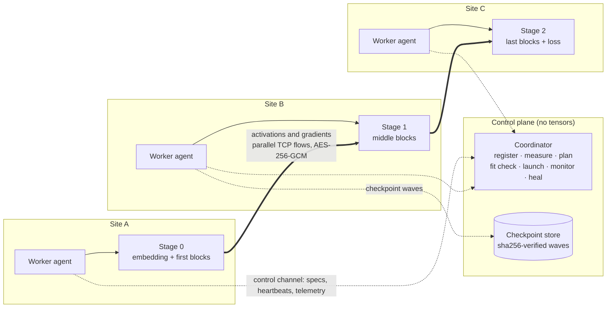

# Elysium

**Unifying the world's AI compute.**

Elysium trains one model on GPUs that live in different data centers, over the ordinary internet. We cut the model
into pipeline stages, put each stage wherever there is a GPU, and send only the activations between sites. Any run can
be checked bit for bit against the same model trained on a single device.

[Website](https://elysium-network.vercel.app/) · [Results](#benchmarks-and-evaluation) · [Quick start](#quick-start) ·
[How it works](#how-elysium-works) · [Capabilities](#current-capabilities) · [Roadmap](#roadmap) ·
[Contributing](#contributing)

<picture>
  <source media="(prefers-color-scheme: dark)" srcset="docs/assets/step-timeline-dark.png">
  
</picture>

<sub>One real training step, measured rather than simulated: a 15.8B-parameter model on two H100s 6,900 km apart,
with both GPUs on the same clock ([run report](benchmarks/wan/runs/2026-10-13-h100/REPORT.md)).</sub>

**Where things stand.** Elysium is early research software, not a product yet. On real hardware it has:
- trained dense GPT models from 607M to 25.1B parameters over the public internet, on GPUs rented by the hour;
- matched a single H100 bit for bit, with a 2.8B model trained between Czechia and Denver producing exactly the same
  320 losses;
- reached 3,344 tokens/s on a 15.8B model split between Virginia and Czechia, with the GPUs busy 78% and 92% of each
  step;
- survived a worker crash in a 70-second laptop demo and still matched the single-device reference.

Mixing GPU vendors, running a public compute network and running in production are where we're headed, not where we
are.

## The problem

Today's training stacks assume all your GPUs sit in one building. Data parallelism and fully sharded data parallelism
exchange a full set of gradients or weights on every step [6][7], and tensor parallelism communicates inside every
layer [8]. That works because NVLink gives a Blackwell GPU 1.8 TB/s to its neighbors [13] and InfiniBand connects the
racks. Between two data centers you get something like 1–10 Gb/s and 50–150 ms of latency, roughly a thousand times
less bandwidth.

Meanwhile, GPUs are expensive and scattered across clouds, smaller providers, universities and rented machines in
dozens of regions. Each pool is usually too small, or too far from the others, to train a large model on its own, and
a model that doesn't fit in one pool can't borrow the rest.

The internet also misbehaves in ways a datacenter fabric doesn't. We measured these on real routes:
- one TCP flow across the Atlantic carried only 41–49 Mbps between machines with multi-gigabit network cards;
- a home connection lost packets in bursts that stretched training steps to over a minute;
- 32 parallel flows sending in bursts lost 0.35% of their packets.

A synchronous step waits for its slowest stage and its slowest link, so all of this turns into idle GPUs. In our
first transatlantic run, the GPUs spent 72–79% of each step waiting.

Hardware isn't interchangeable either. Different GPU models, even ones that differ only in their number of streaming
multiprocessors, pick different kernels, so the same math can produce different bits. Different vendors bring
different stacks: CUDA, ROCm, XLA, Neuron. Pooling them changes performance, and it makes runs hard to reproduce and
to verify.

## The vision

We want AI compute to behave like one programmable layer, instead of something that only works when every
accelerator sits in the same datacenter. You would describe a training job once. The system would measure the
machines and links available anywhere, place the work where it fits and runs best, and hand back the same model, bit
for bit, that one big machine would have produced.

The [target architecture](docs/VISION.md) takes this further: GPUs, TPUs, Trainium and AMD in one run, each stage on
its own native runtime behind a common tensor contract. The [website](https://elysium-network.vercel.app/) shows
where the product is going.

We're not there. What exists today is the first layer: an engine that trains one model across sites on fleets of
identical NVIDIA GPUs. Its correctness check is strict enough that we can change schedules, links and partitions
without wondering whether the model still learns the same thing.

## How Elysium works


## How it compares

| | Data / fully sharded parallelism in one cluster [6][7][8] | Low-communication training (DiLoCo, INTELLECT-1) [9][10][11] | Decentralized pipelines (SWARM) [12] | Elysium |
|---|---|---|---|---|
| What crosses the slow link | Gradients or weights every step | Pseudo-gradients every H local steps | Activations, routed stochastically | Activations at fixed stage boundaries |
| Training algorithm | Standard | Changed (inner and outer optimizers) | Standard pipeline, randomized wiring | Standard synchronous training |
| Reproducible bit for bit against one device | No | No, by design | No | Yes, by design |
| Built for | One cluster | Many sites, each holding the full model | Unreliable volunteer devices | Sites that each hold one part of the model |

## Current capabilities

**IMPLEMENTED** means built and proven on GPUs. **PARTIAL** means proven on CPU but not yet on GPUs, or still being
built. **RESEARCHING** means designed, not built yet.

| Component | Status |
|---|---|
| Pipeline-parallel training (zero-bubble F/B/W) | **IMPLEMENTED** |
| Byte-exact validation against a single device | **IMPLEMENTED** |
| Models larger than one GPU | **IMPLEMENTED** |
| WAN transport (parallel flows, kernel pacing, lossless codec, AES-256-GCM) | **IMPLEMENTED** |
| Orchestration (measure, plan, fit check, launch, monitor) | **IMPLEMENTED** |
| Host-memory optimizer state and recomputation | **IMPLEMENTED** |
| Failure detection, heal from spares, resume from checkpoint waves | **PARTIAL** |
| Re-cut a run to another partition at a checkpoint | **PARTIAL** |
| Heterogeneous device maps (CUDA, MPS and CPU in one run) | **PARTIAL** |
| Sharded wide stages (FSDP-style pieces, ADR-0006) | **PARTIAL** |
| Mixture-of-Experts with deterministic routing (ADR-0008) | **PARTIAL** |
| HuggingFace dense decoders (`arch: hf`) and user models (`arch: user`) | **PARTIAL** |
| bf16 working weights with fp32 masters in host memory | **PARTIAL** |
| Benchmarks | **PARTIAL** |
| Any HuggingFace decoder through its own modules | **RESEARCHING** |
| GPU, TPU and Trainium backends in one run  | **RESEARCHING** |

## Quick start

You need Python 3.10 or newer and [uv](https://docs.astral.sh/uv/). `uv sync` installs PyTorch 2.4 or newer, NumPy,
zstandard and cryptography.
- **Where it has run.** The CPU demo on macOS (Apple Silicon), and GPU runs on Linux containers with NVIDIA H100 and
  RTX cards. Windows hasn't been tried.
- **What hardware you need.** The demo needs only a laptop CPU. A GPU run needs one NVIDIA GPU per pipeline stage.

```bash
git clone https://github.com/virgiliolrf/elysium-wan.git
cd elysium-wan
uv sync
```

### Try it on your laptop

This command starts a coordinator and five workers. They form a four-stage pipeline in two emulated regions, joined by
a 60 Mb/s, 60 ms link, and one worker is killed at step 6:

```bash
uv run python examples/wan_cluster_demo.py --workers 5 --stages 4 --kill-at 6
```

It takes about 70 seconds on an M4 MacBook Air. You should see something like this:

```text
>>> killing w0 (agent and stage) at step >= 6
[coord error] slot (1, 0) convicted: worker unreachable: control connection lost 4s ago and not re-established
[coord info] replacement for slot (1, 0): w3 -- identical device (cpu) in a surviving node's region: ...
[coord info] every slot resumes after step 5 under the original spec
[coord info] run ... complete: 240 losses, 2 attempt(s), 1 heal(s), 0 restart(s), 0 rebalance(s)
vs single-device reference: {"ok": true, "compared": 240, "mismatches": 0, "max_abs_diff": 0.0, "first_mismatch": null}
```

The last line is the one that matters. After losing a worker and healing, the four-stage run produced exactly the same
240 losses as a single device.

Add `--mps` to put one worker on the Apple GPU. The demo then skips the comparison, because a mixed device map has no
single-device reference.

### Run on real machines

Start one coordinator and one worker per machine. The token authenticates the workers:

```bash
# the coordinator (control plane only)
WANTRAIN_COORD_TOKEN=<secret> uv run wantrain coordinator --port 28000 --job job.json --any-region

# every worker
WANTRAIN_COORD_TOKEN=<secret> uv run wantrain worker --coordinator <coordinator-ip>:28000 \
    --advertise-host <public-ip> --data-port 29000 --region eu-west --device cuda
```

- **Regions.** `--any-region` lets one run span workers in different regions. Without it, the coordinator picks
  workers from a single region.
- **The job file.** It is `{"plan": {...}, "stages": N}`, with the model shape, dataset, steps, microbatches and
  optimizer. The planner works out the cut, the schedule and the memory mode from the measured fleet. The job files in
  [`benchmarks/wan/`](benchmarks/wan/) are working examples.
- **Data.** Tokenize a corpus with
  `wantrain prepare-data --corpus corpus.txt --source-type txt --out data.bin --tokenizer gpt2`. The GPT-2 tokenizer
  needs the `data` extra.

### Rented GPUs

[`benchmarks/wan/cluster.py`](benchmarks/wan/cluster.py) drives the whole flow from your own machine:

```bash
cd benchmarks/wan
python cluster.py check nodes.txt                    # driver, TLS, disk, bandwidth
python cluster.py setup nodes.txt code.tar.gz        # engine and corpus on every node
python cluster.py discover nodes.txt                 # public IPs and port maps -> nodes.json
python cluster.py sustain nodes.json job.json        # every pair loaded both ways; picks the microbatch count
python cluster.py launch nodes.json job.json         # coordinator plus one worker per node
python cluster.py watch nodes.json                   # per step: tokens/s, idle per stage, slow stages
```

It currently assumes Vast.ai-style containers (mapped ports and `vast-capabilities`) and an SSH key at
`~/.ssh/elysium_vast`.

## Architecture and research

Every rule the engine keeps has a number, like RUNTIME-I27, and lives in a SPEC document:
[runtime](docs/design/SPEC-runtime.md), [scheduler](docs/design/SPEC-scheduler.md),
[transport](docs/design/SPEC-transport.md), [control](docs/design/SPEC-control.md) and [model](docs/design/SPEC-model.md).
Bigger decisions are recorded as [ADRs](docs/design/adr/). A few of them shape everything else.

- **Exactness is designed in, not tested in afterwards.**
  - Gradients are summed in a fixed microbatch order, whatever order they arrive in.
  - Kernels are pinned to deterministic implementations.
  - The wire is lossless.
  - Initialization replays one seeded stream in a fixed order, so the bits never depend on where the model is cut.
  - Any change that alters the numerics counts as a new recipe, and the single-device reference has to run it too.
- **There is one execution model.** It is zero-bubble pipeline parallelism, with the schedule solved for each run from
  measured costs. The automatic schedule is a port of the reference implementation's heuristic, extended with
  per-stage costs and per-hop communication [1].
- **Each stage uses one device class** (ADR-0005). Bits are guaranteed within a device class; a mixed fleet is compared
  with a run on the same device map.
- **Each stage builds only its own layers** (ADR-0007, RUNTIME-I22), so the model can be bigger than any single GPU.

There are plenty of open questions:

- **How should a pipeline use a WAN?** Pipelines suit WANs because only boundaries cross sites, but every boundary sits
  on the critical path. ZB-V [2] halves the bubble and the activation memory, yet crosses each WAN boundary twice.
  Whether that pays off depends on the link, so the planner should decide per link.
- **How do we save bandwidth without changing the bits?** Lossy compression and low-communication optimizers [9][10]
  save bandwidth by changing what the model learns. We keep the wire lossless and look elsewhere:
  - how the transport behaves after idle periods;
  - how many bytes each token costs at the boundary;
  - how much of the optimizer can overlap with communication.
- **Can different vendors agree on the bits?** Running one stage per device class is designed (ADR-0005) and partly
  built. Getting different vendors to produce identical bits is an open problem. In our measurements on an H100, exact
  accumulation cost 2.7–7.7× on the GEMM term (research branch `research/exact-native-speed`) [14].
- **What should a backend layer look like?** The native backend layer and the tensor contract in the
  [target architecture](docs/VISION.md) are planned, not built.

## Benchmarks and evaluation

Everything below ran on GPUs rented by the hour on Vast.ai. Each row links to a report with the raw stage logs,
per-operation telemetry, losses and charts.
- **Throughput** is tokens per step divided by the median step time, over steady-state steps. We skip the first one or
  two steps.
- **Waiting** is the share of a step a stage spent with nothing to run, waiting for a message.

| Date | Model | Hardware and route | Batch | Throughput | Waiting |
|---|---|---|---|---|---|
| 10-12 | 607M | RTX 3070 Laptop, Bellevue ↔ RTX 3060, Seoul; residential, 156 ms | 4,096 tokens | 1,741 tok/s | 84% / 60% |
| 10-12 | 2.8B | 2× H100 NVL, Czechia ↔ Denver, 134 ms | 16,384 tokens | 2,047 tok/s (one H100 alone: 5,304) | 72–79% |
| 10-12 | 13.5B | 2× H100 NVL, Virginia ↔ Czechia | 32,768 tokens | 2,575 tok/s | 14% / 34% |
| 10-12 | 25.1B | 4× H100 SXM, US, Czechia (2), Germany | 65,536 tokens | ~2,500 tok/s | 28–50% |
| 10-13 | 15.8B | 2× H100 NVL, Virginia ↔ Czechia, 103 ms | 131,072 tokens | **3,344 tok/s** | 6% / 20% |

A few notes on each run:

- **607M on home internet** ([report](benchmarks/wan/runs/2026-10-12-us-kr-607m/REPORT.md)).
  - Setup: d 1536, 16 layers, sequence 512, bf16, TinyStories.
  - Result: 606 steps in 30 minutes, loss from 11.03 to 3.07.
  - Limits: with only 8 microbatches per step the run was latency-bound, and the residential route lost packets in
    bursts.
- **2.8B** ([report](benchmarks/wan/runs/2026-10-12-h100/REPORT.md)).
  - Setup: d 2560, 32 layers, sequence 1024, bf16 with recomputation and host-memory moments, 20 steps of 16
    microbatches.
  - Baseline: one H100 running the same recipe.
  - Limits: this run came before our TCP tuning, when one flow carried only 41–49 Mbps.
- **13.5B** ([report](benchmarks/wan/runs/2026-10-12-us3/REPORT.md)).
  - Setup: d 5632, 34 layers, 32 microbatches.
  - Result: loss from 11.06 to 5.95 in 31 steps.
- **25.1B** ([report](benchmarks/wan/runs/2026-10-12-sxm4/REPORT.md)).
  - Setup: d 6144, 54 layers, 64 microbatches, about 26 seconds per step.
  - Limits: a node capped by its network card and a noisy host set the pace.
- **15.8B** ([report](benchmarks/wan/runs/2026-10-13-h100/REPORT.md)).
  - Setup: d 5632, 40 layers, sequence 1024, bf16 with flash attention, recomputation and host-memory moments, 128
    microbatches, TinyStories.
  - Result: 39.2 seconds per step and 19% MFU (6·N·tokens/s over 2 × 835 TFLOPs). Loss from 11.00 to 6.05 in 35
    steps, before the budget ran out.
  - Cost: the GPUs cost $6.93 an hour. Network egress added about $0.17 per step, more than the GPUs themselves.
  - Before TCP pacing and flash attention, the same model reached 2,726 tokens/s earlier that day.

Read these numbers with care:
- The runs are short (11 to 606 steps) and mostly single attempts.
- The fleets differ from row to row, so this isn't a scaling study.
- The only same-workload baseline is the single H100 in the 2.8B run.

To reproduce a figure:
- [`bench_report.py`](benchmarks/wan/bench_report.py) turns a collected run into charts and a summary.
- [`step_timeline.py`](benchmarks/wan/step_timeline.py) draws the figure at the top of this page.
- [`msgbench.py`](benchmarks/wan/msgbench.py) measures how long a boundary message takes on a given path.

## Roadmap

What already works is in [Current capabilities](#current-capabilities). Here's what comes next, with no dates
attached.

**What we're working on now**
- **Balancing stages on measured costs.** We calibrate the cut on step 0's real timings, then restart from step 0.
  Runs don't depend on the cut, so the bits stay the same.
- **Keeping bf16 working weights on the GPU, with fp32 masters in host memory.** Today each linear layer casts its fp32
  weight to bf16 three times per microbatch, 31% of a block's forward pass on an H100. The change frees GPU memory and
  keeps the same bits.
- **Longer runs, and exactness across cuts at 15B and beyond.** This includes learning-rate warmup: the first Adam
  step currently makes the loss spike.
- **Selective recomputation on by default,** once we understand an intermittent CUDA NaN in its keep-graph mode.

**What we're researching**
- Heterogeneous device maps on GPU fleets (ADR-0005), and exact arithmetic across vendors.
- WAN-aware scheduling: ZB-V where links allow it, a transport that keeps its window across idle periods, and
  placement that accounts for egress prices.
- Wider fleets: MoE and sharded wide stages on real GPUs, with 4 to 9 GPUs per run.
- Any HuggingFace decoder through its own modules, checked against `transformers` (ADR-0009).

**Where this could go**, following the phases in the [vision](docs/VISION.md):
1. Homogeneous GPUs across sites (where we are now).
2. Any model architecture.
3. Heterogeneous accelerators in one run: NVIDIA, AMD, TPU and Trainium, each stage on its native runtime.
4. A global compute fabric with multi-region scheduling and cost-aware placement.
5. Tools that show placement, link cost, bubble and price before you rent anything.

## Contributing

We'd love help, especially from people who know kernel determinism, WAN transport, pipeline scheduling,
heterogeneous backends or fault tolerance.

`uv sync` also installs the development tools: pytest, ruff, mypy and hypothesis. Before sending a change, run:

```bash
uv run ruff format src tests                                  # formatting
uv run ruff check src tests                                   # lint
uv run pytest -q tests/unit                                   # 1,114 unit tests
uv run pytest -q tests/integration/test_engine_bitwise.py     # 354 multi-process cases, diffed bit for bit
uv run pytest -q tests/chaos tests/oracle tests/wan           # worker death, oracles, WAN emulation
```

A few habits keep this codebase honest:
- **Every behavior has a numbered invariant** in a SPEC document, and tests and code cite it. When a SPEC changes, we
  append its sha256 and the reason to [`docs/design/FROZEN.json`](docs/design/FROZEN.json).
- **Tests say what they cover and what would make them fail,** in `covers:` and `WOULD-FAIL-IF:` lines.
- **A speedup has to keep the bits.** If it changes the numerics, it's a new recipe, and the reference must run it too.
- **Measure before you theorize.** Every GPU run leaves per-operation telemetry, and the fixes in the run reports came
  from reading it.
- **An agent factory writes much of the code.** It lives in [`agents-architetura/`](agents-architetura/) and follows
  [`CLAUDE.md`](CLAUDE.md). Merges to `main` and paid GPU time stay with a person.

The full guide is in [CONTRIBUTING.md](CONTRIBUTING.md), and everyone taking part follows the
[code of conduct](CODE_OF_CONDUCT.md). Found a bug or have an idea? Open a GitHub issue. For larger changes, start the discussion there before opening a pull
request. Please report security issues privately through GitHub security advisories; the threat model is in
[`THREAT_MODEL.md`](docs/design/THREAT_MODEL.md).

## Documentation

| If you want to... | Start here |
|---|---|
| Understand the design and its cost model | [DESIGN.md](docs/design/DESIGN.md) |
| Run and debug the engine | [docs/engine/ARCHITECTURE.md](docs/engine/ARCHITECTURE.md) |
| Know the rules each subsystem keeps | the SPEC documents above |
| See why each big decision was made | [ADRs](docs/design/adr/) |
| Read every GPU run with its raw data | [benchmarks/wan/runs/](benchmarks/wan/runs/) |
| Know what we defend against | [THREAT_MODEL.md](docs/design/THREAT_MODEL.md) |
| See the long-term architecture | [VISION.md](docs/VISION.md) |

## License, acknowledgments, and references

**License.** Elysium is released under the [Apache License 2.0](LICENSE); see also [NOTICE](NOTICE).

**Contributors.** Virgilio Filho ([@virgiliolrf](https://github.com/virgiliolrf)), with the agent factory described
above.

**Acknowledgments.**
- The pipeline schedule builds on Zero Bubble Pipeline Parallelism [1] and its reference implementation
  ([sail-sg/zero-bubble-pipeline-parallelism](https://github.com/sail-sg/zero-bubble-pipeline-parallelism)).
- The engine stands on [PyTorch](https://pytorch.org), [zstandard](https://github.com/indygreg/python-zstandard) and
  [cryptography](https://cryptography.io), plus tiktoken and Hugging Face Transformers for optional features.
- The GPU experiments ran on machines rented through [Vast.ai](https://vast.ai).

**References.**
1. P. Qi, X. Wan, G. Huang, M. Lin, "Zero Bubble Pipeline Parallelism", ICLR 2024. [arXiv:2401.10241](https://arxiv.org/abs/2401.10241)
2. P. Qi, X. Wan, N. Amar, M. Lin, "Pipeline Parallelism with Controllable Memory", 2024. [arXiv:2405.15362](https://arxiv.org/abs/2405.15362)
3. Y. Huang et al., "GPipe: Efficient Training of Giant Neural Networks using Pipeline Parallelism", NeurIPS 2019. [arXiv:1811.06965](https://arxiv.org/abs/1811.06965)
4. D. Narayanan et al., "PipeDream: Generalized Pipeline Parallelism for DNN Training", SOSP 2019. [arXiv:1806.03377](https://arxiv.org/abs/1806.03377)
5. B. Yuan et al., "Decentralized Training of Foundation Models in Heterogeneous Environments", NeurIPS 2022. [arXiv:2206.01288](https://arxiv.org/abs/2206.01288)
6. S. Rajbhandari et al., "ZeRO: Memory Optimizations Toward Training Trillion Parameter Models", SC20. [arXiv:1910.02054](https://arxiv.org/abs/1910.02054)
7. Y. Zhao et al., "PyTorch FSDP: Experiences on Scaling Fully Sharded Data Parallel", VLDB 2023. [arXiv:2304.11277](https://arxiv.org/abs/2304.11277)
8. D. Narayanan et al., "Efficient Large-Scale Language Model Training on GPU Clusters Using Megatron-LM", SC21. [arXiv:2104.04473](https://arxiv.org/abs/2104.04473)
9. A. Douillard et al., "DiLoCo: Distributed Low-Communication Training of Language Models", 2023. [arXiv:2311.08105](https://arxiv.org/abs/2311.08105)
10. A. Douillard et al., "Streaming DiLoCo with overlapping communication", 2025. [arXiv:2501.18512](https://arxiv.org/abs/2501.18512)
11. S. Jaghouar et al., "INTELLECT-1 Technical Report", 2024. [arXiv:2412.01152](https://arxiv.org/abs/2412.01152)
12. M. Ryabinin, T. Dettmers, M. Diskin, A. Borzunov, "SWARM Parallelism: Training Large Models Can Be Surprisingly Communication-Efficient", ICML 2023. [arXiv:2301.11913](https://arxiv.org/abs/2301.11913) · [code](https://github.com/yandex-research/swarm)
13. NVIDIA, Multi-Node NVLink systems: 1.8 TB/s per Blackwell GPU. [docs.nvidia.com](https://docs.nvidia.com/multi-node-nvlink-systems/multi-node-tuning-guide/overview.html)
14. J. Demmel, H. D. Nguyen, "Parallel Reproducible Summation", IEEE Transactions on Computers, 2015. [doi:10.1109/TC.2014.2345391](https://doi.org/10.1109/TC.2014.2345391)
