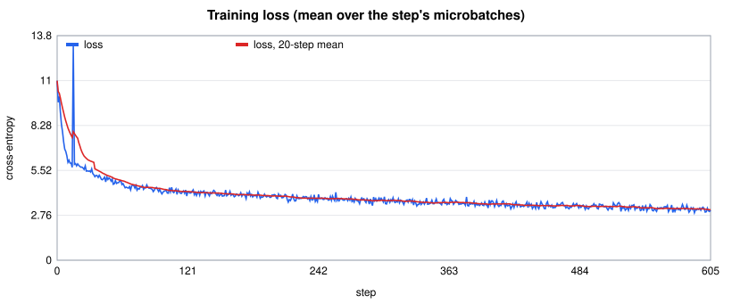
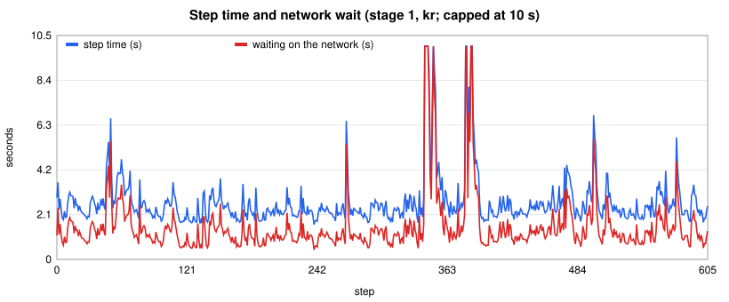
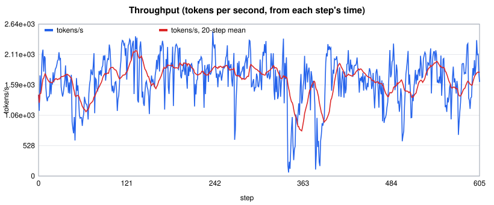
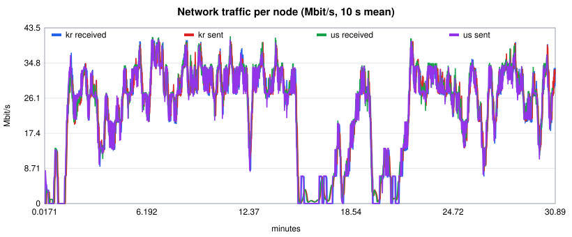
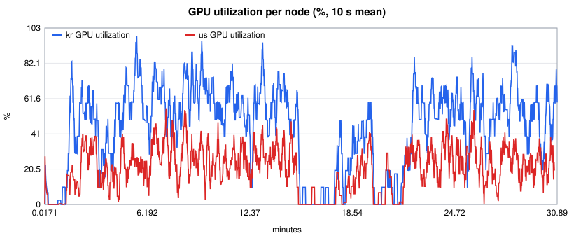

# WAN training run

- Model: 607M params (d_model 1536, 16 layers, vocab 50257, seq 512), bf16 compute, bf16 boundary, partition [[0, 7], [7, 18]]
- Steps: 606; 4096 tokens/step (8 x 1 x 512)

| Metric | Value |
|---|---|
| Tokens/s (median step) | 1741.1 |
| Tokens/s (wall clock) | 1388.1 |
| Step time median / p10 / p90 (ms) | 2352.5 / 1895.3 / 3663.6 |
| Engine link probe | 39.2 / 32.95 Mbps, RTT 156.91 ms |
| iperf3 from us (1 / 4 streams) | 110.4 / 222.0 Mbps; TCP RTT median 155.91 ms |
| Loss first -> last (min) | 11.0273 -> 3.0682 (2.9203) |

| Stage | Node | F / B / W ms | Stall share | Hop MB/step | GPU peak GiB |
|---|---|---|---|---|---|
| 0 | us | 16.81 / 30.54 / 2.53 | 84.1% | 8.6 | 5.39 |
| 1 | kr | 27.11 / 90.56 / 31.28 | 60.1% | 8.61 | 9.01 |

| Node | GPU util mean (active) | Power W | NIC rx / tx Mbps mean (p95) | Moved GB |
|---|---|---|---|---|
| kr | 44.9% (92.1%) | 81.1 | 23.19 / 23.2 (65.73 / 62.27) | 10.763 |
| us | 20.5% (66.4%) | 63.7 | 23.16 / 22.85 (63.27 / 66.38) | 10.606 |

## Charts

The network chart shows the residential route dropping to near zero between minutes ~15 and ~21 (the 16-66 s steps
around step 341 and the gap after it); throughput recovered on its own each time.

## Fleet

| Node | Where | GPU | Network |
|---|---|---|---|
| us | Bellevue, WA, US (Comcast, residential) | RTX 3070 Laptop GPU, 7.66 GiB, 29.5 TFLOPs measured | Vast.ai port-mapped |
| kr | Seoul, KR (LG Powercomm, residential) | RTX 3060, 11.63 GiB, 23.5 TFLOPs measured | Vast.ai port-mapped |

Corpus: the first 400 MB of TinyStories-train, GPT-2 tokens (105,112,084 tokens), the same bytes on both nodes (manifest
digest 2525ff97...). Run: 30 minutes of wall clock, stopped by the operator at step 606 of 900.

This was an operator run of the engine, not a factory test. The recipe is exact by construction (fp32 master weights,
fixed-order gradient folds, lossless wire), but this run was not compared bit for bit against an oracle: the fleet
mixes two GPU models (`WANTRAIN_DEVICE_CLASS=arch`), and the oracle of a mixed map is per device map (ADR-0005).

## Findings

- **It trains across the Pacific.** A 607M-parameter model neither GPU could hold alone (~21 B/param of weights,
  gradients and AdamW state is ~12.7 GB) trained for 30 minutes between Washington and Seoul: loss 11.03 -> 3.07.
  Effective compute: 6 x 607M x 1,741 tok/s = 6.3 TFLOP/s, about 12% of the two cards' measured peak.
- **The pipeline is latency-bound, not bandwidth-bound.** Each step moves 8.6 MB per direction. The NIC averaged
  23 Mbps of a link that carries 110-222 Mbps. Stage 0 waited 84% of each step and stage 1 60%: with 8 microbatches
  per step and a 156 ms RTT, the boundary round trips dominate. More microbatches per step (more tokens per round trip)
  is the lever, and it needs memory on stage 0.
- **The residential route lost packets in bursts.** Around steps 341-345 and again near step 512, steps took 16-66 s,
  almost all of it waiting on the network: TCP's retransmission backoff. Four parallel streams help bandwidth but not
  this: a fragment lost on one stream holds the whole microbatch. Datacenter hosts avoid most of it; the engine could
  resend a stalled fragment on another stream.
- **The engine's link probe under-reads a long fat pipe.** It measured 33-39 Mbps on one stream; iperf3 got 110 on
  one and 222 on four. The plan used 4 streams (`p2p_streams`).
- **Bugs found and fixed on the way** (commit bcdf167): the fit check measured fp32 graphs of every in-flight
  microbatch even under recompute (every plan refused); the HF gate flagged files of namespace packages shared by
  CUDA wheels as foreign (346 false FP-RECORD problems on Linux CUDA, 0 after); a worker behind a port map could not
  advertise its probe port; and same-architecture GPUs of different models are now an operator choice
  (`WANTRAIN_DEVICE_CLASS=arch`).
