# 2026-10-13: 15.8B over the Atlantic on two H100 NVL

A 15.8B dense GPT trained across two H100 NVL, one in Virginia and one in Czechia, 103 ms apart. No single H100
holds this model with its optimizer: 15.8B at 16 bytes per parameter is 253 GB.

Two runs of the same model on the same data:
- **run 1:** the engine as it stood in the morning;
- **run 3:** with three changes found in run 1's telemetry: TCP pacing, flash attention, and a gradient fold without
  the widened copy.

Run 3 reached **3,344 tokens/s**, 23% more than run 1 and the best of every Elysium WAN run so far. Both runs stopped
when the rented credit ran out: 11 and 35 steps. Run 2 was a false start, stopped during setup.

Charts are in [`run3-16b-100steps/charts/`](run3-16b-100steps/charts/). `benchmarks/wan/bench_report.py` regenerates
them from the collected logs.

## Setup

| | |
|---|---|
| Model | GPT, d 5632, 40 layers, 44 heads, seq 1024, vocab 50257: **15.79B parameters** |
| Precision | bf16 compute and boundary, fp32 master weights and gradients |
| Memory recipe | recompute; `adamw-host` (moments in host memory, RUNTIME-I20/I24) |
| Data | TinyStories, GPT-2 tokens: 105M tokens on each node |
| Batch | 128 microbatches of 1 x 1024 tokens = **131,072 tokens per step** |
| Fleet | H100 NVL in Virginia (Azure, 40 vCPU) → H100 NVL in Czechia (2x EPYC 9554) |
| Link | RTT 103–106 ms; 32 TCP flows per hop; `cluster.py sustain`: ≥904 Mbps each way under two-way load |
| Cut | embedding + 21 blocks \| 19 blocks + head, chosen by the partition DP from profiled costs |
| Schedule | zero-bubble (F/B/W split), auto memory mode |

## Results

| | run 1 | run 3 |
|---|---|---|
| Attention | naive (materialised scores) | `sdpa/flash` |
| Transport | 32 CUBIC flows, unpaced | 32 flows, kernel pacing (TRANSPORT-I13) |
| Weight-gradient fold | widen, then add | narrow add (RUNTIME-I28) |
| Steps (steady state) | 11 (2–10) | 35 (2–33) |
| Step time, median | 48.1 s | **39.2 s** |
| Tokens/s, median | 2,726 | **3,344** |
| MFU (6·N·tokens/s over 2 × 835 TFLOPs) | 15.5% | **19.0%** |
| Idle, stage 0 / stage 1 (waiting for a message) | 2.2% / 9.3% | 5.9% / 20.1% |
| GPU not computing F/B/W, stage 0 / stage 1 | 5.3% / 10.7% | 9.7% / 22.2% |
| ms per microbatch, stage 0 / stage 1 (F+B+W) | 356 / 340 | 282 / 233 |
| Peak memory, stage 0 / stage 1 | 75.7 / 74.2 GiB | 70.5 / 68.2 GiB |
| Activation arrival, first fragment to whole | median 417 ms, p90 747 | median 128 ms, p90 242 |
| Loss | 11.00 → 6.31 (step 10) | 11.00 → **6.05** (step 34) |

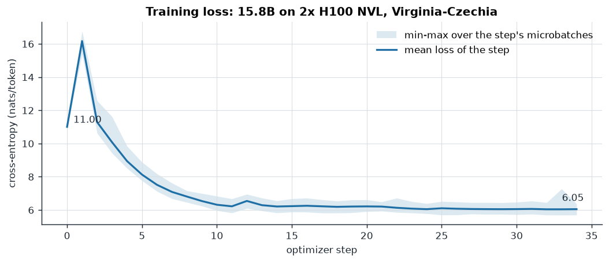

**Loss.**
- Steps 0–6 of the two runs agree to three decimals. They are not bit-identical: run 3 uses another attention
  kernel, so it is another recipe.
- Step 1 jumps to 16.2 in both runs. It is the first Adam step with no learning-rate warmup, which the engine does
  not have yet.
- The loss falls to 6.3 by step 10, then descends slowly to 6.05. That is the early, unigram-statistics phase: 4.6M
  tokens is 0.0003 tokens per parameter. This was a systems benchmark, not a model meant to converge.

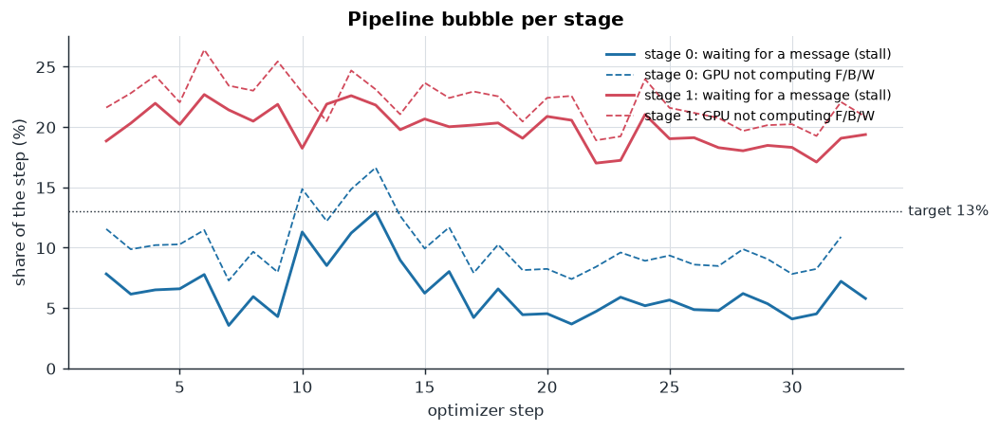

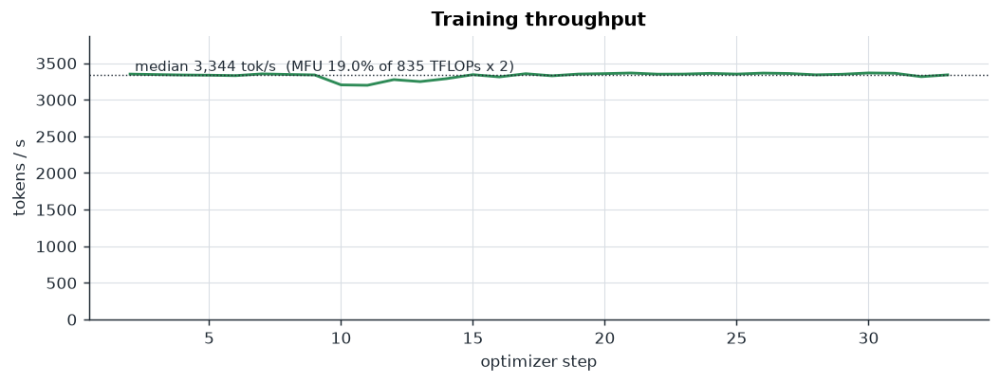

**Why idle went up while throughput went up 23%.**
- Flash attention cut stage 1 far more than stage 0. Stage 1's backward went from 241 to 148 ms; stage 0's total went
  from 356 to 282 ms.
- The cut was priced on the profile, which measured the two stages within 1% of each other. At runtime stage 0 needs
  282 ms per microbatch and stage 1 needs 233.
- Stage 1 therefore waits about 5.6 s per step for stage 0. That is half of its 20% idle.

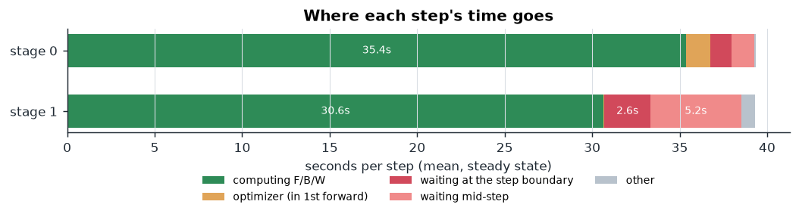

## The step boundary, on one clock

The two nodes' clocks are aligned from message pairs: the minimum of send-to-arrival in each direction gives the
offset and the one-way latency, 50–58 ms.

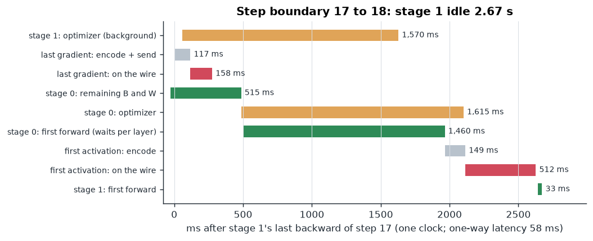

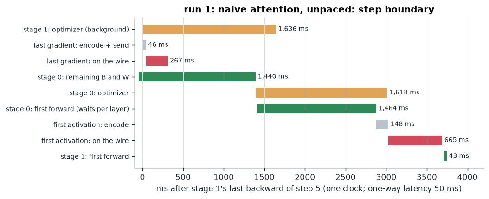

Between two steps stage 1 waits 2.85 s in run 3, against 3.75 s in run 1. The critical path:
1. **Stage 0 finishes its backlog: 0.5 s** (1.4 s in run 1).
2. **Stage 0's optimizer: 1.6 s.**
   - The moments cross PCIe both ways at ~41 GB/s per direction, 66 GB each way per step: the hardware floor for
     host-resident moments.
   - The next forward follows it layer by layer (RUNTIME-I23/I24).
   - Stage 1's optimizer runs while stage 0 drains, so it is off the critical path.
3. **The first activation after ~2 s of silence: 0.6 s on the wire.**
   - Every flow has been idle longer than one RTO, so the kernel restarts its window from 10 segments.
   - `tcp_slow_start_after_idle` is read-only in Vast containers, and pacing does not change it.

## What was wrong in run 1, and the fixes

**1. Packet loss from line-rate bursts (TRANSPORT-I13).**
- **Finding.** In run 1, each of the 32 VA→CZ flows showed 131–686 retransmissions, ~0.35% of bytes.
  - A 7.9 MB boundary spans ~5,400 packets, so almost every boundary lost some.
  - It completed only when its slowest flow recovered: ≥1 RTT, or a 300 ms RTO for a tail loss.
- **Cause.** The containers offer only CUBIC and Reno, no BBR. CUBIC sends each window as a line-rate burst into a
  ~1 Gbps bottleneck.
- **Fix.** `SO_MAX_PACING_RATE` turns on the kernel's own TCP pacing, per socket and unprivileged. With a cap no flow
  reaches, only the congestion control's computed rate counts.
- **Measured outside the engine.** `msgbench.py`, a 7.9 MB message every 357 ms:

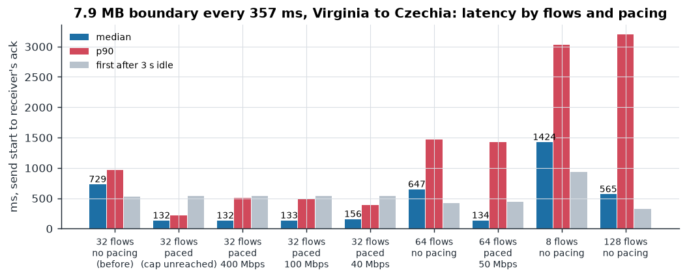

- **Measured inside the engine:**
  - activations arrive whole in 128 ms at the median instead of 417 ms;
  - the coordinator's 32-flow measurement of the VA→CZ hop went from 880 to 6,887 Mbps.

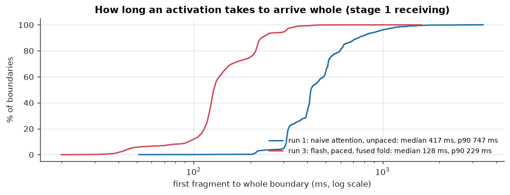

**2. Most GPU time was not matrix multiplication.**

One d=5632 block, profiled on the H100 NVL under the engine's determinism settings:

| | F | F+B |
|---|---|---|
| GPU time, naive attention | 3.44 ms | 11.86 ms |
| GEMM | 46% | 40% |
| fp32 → bf16 weight casts and dtype copies | 31% | 30% |
| fills, fp32 adds, other elementwise | 20% | 28% |
| attention kernels | 3.5% | 2.3% |
| GPU time, `sdpa/flash` | 2.71 ms (−21%) | 9.39 ms (−15%, measured end to end) |

- **Flash and memory-efficient SDPA are deterministic on this GPU.** 5 of 5 forward+backward passes hashed
  identically. cuDNN SDPA has no kernel for this shape.
- **Run 3 switched to flash.** That is a recipe change, and a single-device reference must use the same kernel.
- **The engine widened every bf16 weight gradient to fp32 before adding it to the running sum.** That is a
  2.3 GB-per-layer copy per microbatch at d=5632.
  - **RUNTIME-I28** adds the bf16 tensor directly; `add_` widens it exactly before the same fp32 add.
  - The bits are the same, proven by a unit test.
  - Stage 0's W went from 78 to 64 ms.
  - Gradients held for their predecessor stay half the size.

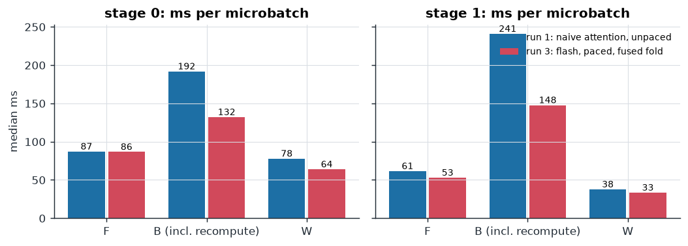

**3. Smaller fixes landed today:**
- a message is cut into one fragment per flow (TRANSPORT-I12; before, 1 MiB fragments used 3 of 16 flows);
- one optimizer CUDA stream per run (a new stream each step grew the allocator's reserve);
- a W task that holds no reference after it finishes (a reference cycle leaked 1.45 GiB per step);
- a stage-log pump that survives a full disk;
- the RTX 4090's effective rate is recalibrated to 40 TFLOPs.

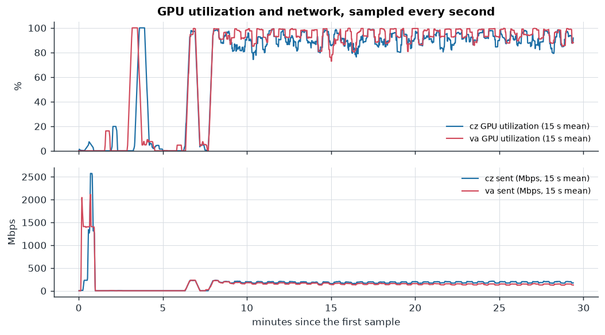

## Exactness

**What holds:**
- The 46 bitwise arms of `tests/integration/test_engine_bitwise.py` that cover today's changes pass. They include bf16
  recipes, multi-flow transport, sub-block W, the host optimizer and re-cut. Each compares a pipeline against its
  single-device reference.
- RUNTIME-I28 is identical by construction and by test.
- Pacing changes only when bytes leave, never which bytes.
- Flash attention is deterministic on the H100 NVL.

**What was not measured today:**
- A single-device reference of this 15.8B model. It does not fit on one GPU.
- A second run of the flash recipe, to compare bit for bit. The budget did not allow one.

**Earlier GPU evidence, same engine:**
- 2.8B Czechia–Denver against one H100: 320/320 losses equal (2026-10-12).
- Four 13.5B runs bit-identical across two routes, two cuts and two schedule modes (us3).
- 0.83B 4090s against one GPU: 320/320.

## Where the next gains are

| Lever | What it removes | Expected |
|---|---|---|
| Re-cut from runtime costs: one block from stage 0 to stage 1 | stage 1's 5.6 s mid-step wait | both stages ~258 ms per microbatch: ~36 s per step, ~3,640 tok/s, stage 1 idle ~10% |
| Master weights in host memory, bf16 weights on the GPU | three weight casts per microbatch (31% of F); PCIe 16 → 6 bytes per parameter per step; 2 bytes per parameter of GPU memory | optimizer boundary ~1.6 s → ~0.6 s; ~10–15% faster compute; ~25% larger model per GPU |
| The first boundary after the optimizer | 0.6 s of TCP restart from an idle window | more flows for that one message, or keep-warm traffic |
| Learning-rate warmup | the step-1 loss spike | (training quality, not speed) |

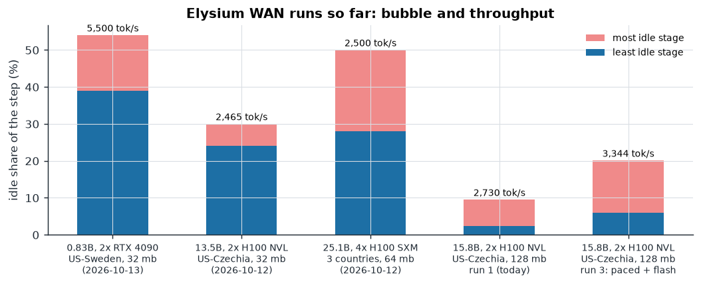

## Cost

| Item | Rate |
|---|---|
| GPUs | $6.93/h ($3.05 Virginia + $3.88 Czechia) |
| Network, Virginia | $0.10 per GB sent |
| Network, Czechia | $0.034 per GB sent, $0.036 per GB received |

Every step moves ~1 GB each way, so the network cost ~$0.17 per step: about $16/h at 3,344 tok/s, more than the
GPUs. The day used about $21 of credit:
- run 1;
- link and message benchmarks;
- the profiling and fit of three launches;
- 35 steps of run 3.

**Pick fleets with free egress.** Bytes per token are fixed by d_model and the lossless codec.

## Files

- `run1-16b-128mb/`, `run3-16b-100steps/`: one directory per node, containing:
  - stage logs;
  - per-op telemetry (`*_telemetry.jsonl.gz`);
  - per-microbatch losses;
  - spec, sysmon and coordinator log.
- `run3-16b-100steps/summary.json`: the numbers above, as `bench_report.py` computes them.
- `transport.json`: the message benchmark (`benchmarks/wan/msgbench.py`); its arms are listed in the
  chart.
- `history.json`: earlier runs' figures, from their own REPORT.md files.
- `job-16b.json` (run 1), `job-16b-100.json` (run 3), `nodes.json`, `sustain.json`.
